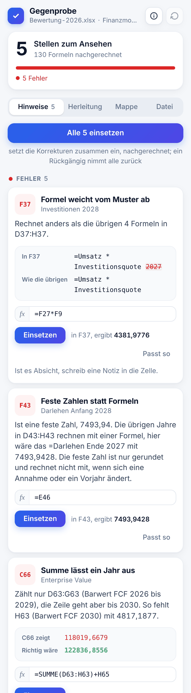

# Crosscheck (Gegenprobe)

**Gegenprobe rechnet deine Excel-Mappe nach und sagt genau, was nicht aufgeht.** Sie steht als Seitenfenster direkt in Excel und arbeitet ohne KI, ohne Internet und ohne Konto. Deine Daten bleiben auf deinem Rechner. Deshalb passt sie auch zu heiklen Daten, etwa aus Spital, Labor oder Buchhaltung. Sie ist kostenlos und quelloffen (MIT) und entstand mit Unterstützung von Claude Code.

*English: [README.md](README.md)*

## Was sie findet

Das Bild zeigt einen echten Test: ein Bewertungsmodell über fünf Jahre (GuV, Investitionen, Darlehen, Free Cashflow, WACC, Terminal Value) mit **fünf versteckten Fehlern. Gegenprobe findet alle fünf** und meldet sonst nichts:

- eine Investitionsformel, die die Quote des Vorjahrs liest,
- ein Darlehensstand, der als Zahl eingetippt ist statt als Formel,
- ein Enterprise Value, dem das letzte Jahr fehlt,
- Steuern, die addiert statt abgezogen werden,
- ein Terminal Value nach Gordon ohne (1 + g).

Zu jedem Fund nennt sie die Zelle, die Ursache und die korrigierte Formel. Diese Formel hat Gegenprobe selbst nachgerechnet. Ein Klick auf **Einsetzen** schreibt sie in die Zelle, und **Rückgängig** nimmt sie wieder heraus.

Außerdem prüft sie Summen gegen ihre Teile, SUMMEWENN, SVERWEIS und XVERWEIS sowie Bereiche, die beim Herunterziehen mitrutschen. Dazu kommen Mittelwerte von Quoten, Statistik (t-Test, Konfidenzintervall, Standardabweichung), Datenqualität (fehlende Werte, Codes wie 999, unmögliche Werte, Duplikate), Pivot-Tabellen und Diagramme. Und sie vergleicht eine Mappe mit einer früheren Version. Alles im Detail: [FUNKTIONEN.md](docs/FUNKTIONEN.md).

 

## In 5 Schritten

Du brauchst Excel am Mac oder unter Windows (Excel 2021, 2024 oder Microsoft 365) und für die Einrichtung einmal Internet. Ein Konto oder Terminal-Kenntnisse brauchst du nicht.

1. **Herunterladen:** Oben den grünen Knopf **Code** und dann **Download ZIP** klicken und die ZIP auspacken (Windows: Rechtsklick → **Alle extrahieren…**).
2. **Ablegen:** Den Ordner **Crosscheck-main** in deinen Benutzerordner legen und danach nicht mehr verschieben.
3. **Einrichten:** **ExcelAddin.command** (Mac) oder **ExcelAddin.bat** (Windows) doppelklicken. Beim ersten Mal musst du die Warnung bestätigen: am Mac unter **Systemeinstellungen → Datenschutz & Sicherheit → Dennoch öffnen**, unter Windows mit **Weitere Informationen → Trotzdem ausführen**. Fehlt Python, holt sie es selbst.
4. **Einmal bestätigen:** Der Mac fragt nach deinem Passwort, Windows fragt, ob es einem lokalen Zertifikat vertrauen soll (**Ja**). Damit vertraut Excel dem Seitenfenster.
5. **In Excel:** Excel ganz beenden und neu öffnen. Unter **Start** steht jetzt der Knopf **Prüfer**.

Geht etwas nicht? Dann hilft die [Hilfe](docs/HILFE.md).

## Datenschutz

- Alles bleibt auf deinem Rechner. Das Seitenfenster schickt die Zellen nur an Gegenprobe auf demselben Rechner (`127.0.0.1`).
- Keine KI, kein Konto, kein Tracking. Gegenprobe speichert nichts aus deinen Mappen.
- Den **Prüfbericht ohne Daten** kannst du weitergeben, auch bei Patientendaten. Er enthält nur Zelladressen und die Art des Hinweises.

## Grenzen

Gegenprobe sucht typische Fehler. Sie kann etwas übersehen und auch etwas melden, das richtig ist. Die eigene Kontrolle ersetzt sie nicht, und sie wird ohne Gewähr bereitgestellt ([MIT-Lizenz](LICENSE)).
