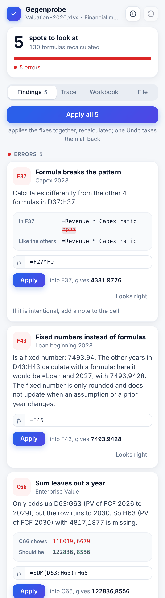

# Crosscheck

**Crosscheck recalculates your Excel workbook and tells you exactly what does not add up.** It sits as a side pane inside Excel, works without AI, without internet and without an account, and your data never leaves your computer. That makes it a fit for sensitive data from hospitals, labs or accounting. Free and open source (MIT). Built with the help of Claude Code.

*Deutsch: [README.de.md](README.de.md)*



## What it finds

The picture shows a real test: a five-year valuation model (income statement, capex, loan, free cash flow, WACC, terminal value) with **five hidden errors. Crosscheck finds all five** and reports nothing else:

- a capex formula that reads last year's ratio,
- a loan balance typed in as a number instead of a formula,
- an enterprise value that leaves out the last year,
- taxes added instead of subtracted,
- a Gordon terminal value without (1 + g).

Each finding names the cell, the cause and the corrected formula. Crosscheck has recalculated the formula itself, so one click on **Apply** puts it in, and **Undo** takes it out again.

It also checks sums against their parts, SUMIF/VLOOKUP/XLOOKUP, ranges that slide when copied, averages of rates, statistics (t-tests, confidence intervals, standard deviation), data quality (missing values, codes like 999, impossible values, duplicates), pivot tables and charts. It also compares a workbook with an earlier version. Everything in detail: [FEATURES.md](docs/FEATURES.md).

<br clear="right">

## Install in 5 steps

You need Excel on a Mac, or on Windows with Excel 2021, 2024 or Microsoft 365. You also need internet once for the setup. You don't need an account or any Terminal skills.

1. **Download:** click the green **Code** button above, then **Download ZIP**, and unpack it (Windows: right-click → **Extract All…**).
2. **Put it in place:** move the **Crosscheck-main** folder into your home folder, and don't move it again afterwards.
3. **Set up:** double-click **ExcelAddin.command** (Mac) or **ExcelAddin.bat** (Windows). The first time, confirm the warning: on a Mac use **System Settings → Privacy & Security → Open Anyway**, on Windows use **More info → Run anyway**. It installs Python by itself if it's missing.
4. **Confirm once:** the Mac asks for your password, and Windows asks whether to trust a local certificate (**Yes**). This lets Excel trust the side pane.
5. **In Excel:** quit Excel completely and reopen it. The **Checker** button now appears under **Home**.

Something not working? See the [Help](docs/HELP.md) page.

## Privacy

- Everything stays on your computer. The pane sends cells only to Crosscheck on the same machine (`127.0.0.1`).
- No AI, no account, no tracking. Crosscheck stores nothing from your workbooks.
- The **report without data** contains only cell addresses and the type of finding, so you can share it even for patient data.

## Limits

Crosscheck looks for typical errors. It can miss some and can flag something that is correct. It does not replace your own review, and it comes without any warranty ([MIT license](LICENSE)).

## Development

```bash
pip install -e ".[dev]"
pytest
```

The code is in `src/voiceagent` (the package keeps its old name). Python 3.10 or newer is required. The only dependencies are FastAPI, Uvicorn and pypdf.
